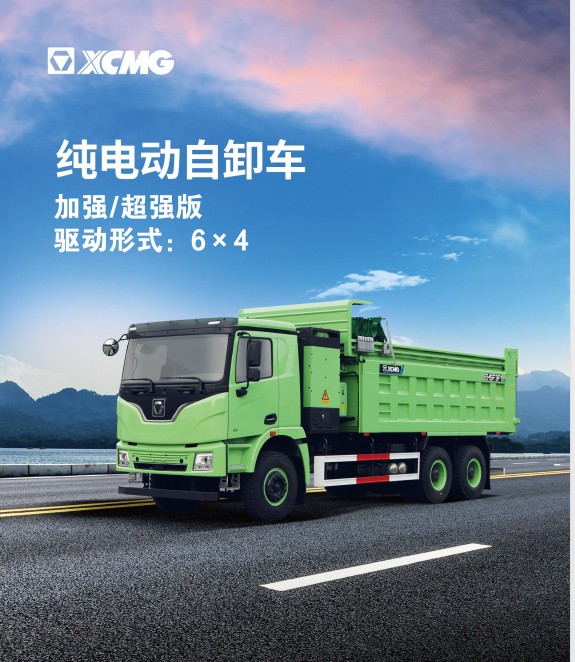
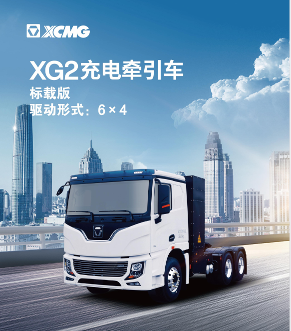

# 正面文案

> 两个 logo 并排放在左上角，润杰在左、徐工在右，中间用竖线隔开。

!! 润杰携手徐工，联合推出
!! 新能源重卡 · 购车3重大礼包
!! 为您**省钱、省心**！

## 产品图（需设计整体效果）

> 两台车并排做整体效果，可加礼盒、丝带等购车礼氛围元素。

> 以下三大礼包用**卡片形式**设计：并排三卡，整体放大，卖点文案可以优化。加粗的关键词单独提出来做成大字标签（放在卡片中部），效果要突出，一眼就能看到。

## 购车直降礼

换购即**送 ¥12000** 电费充值卡，直接抵扣充电费用，用车成本一步降。

## 低门槛上户礼

**低首付**，联合大牌合作挂厂，更低门槛上户上路，缓解现金流压力。

## 省钱保障礼

每台每年**省 4000—6000 元**；合作保险超低价，支持按月分期，有保障没负担。

# 正面底部行动号召

三重大礼 · 限时放送　│　名额有限 · 先到先得

详情请咨询：【留空白，手填号码】　｜　门店／电站地址：四川省成都市青白江区同济大道916号

> 电话位置留白框，后期手写号码，不要放任何号码。正面下方渐变回蓝色。

# 背面文案

!! 购车即享 · 价值**2万元**权益免费送！

换购徐工新能源重卡，购车即享以下权益，让每一分钱都花在刀刃上！

## 购车享8项权益

| 权益项目 | 价值标准 | 周期 | 说明 |
|---|---|---|---|
| 免费充电 | 12000元/台 | 购车即送 | — |
| 免费挪车服务 | 500元/月/台 | 1个季度 | 免费挪车 |
| 免费停车 | 500元/月/台 | 1个季度 | 站内免费停车 |
| 免费住宿 | 500元/月/间 | 1个季度 | 司机休息间 |
| 免费办公 | 1000元/间 | 1个季度 | 办公休息间 |
| 免费车辆检测 | 688元/月 | 一个月 | 免费检测 |
| 货车专用导航路线 | — | — | 专用导航 |
| 免费查询全国禁限行 | — | — | 禁限行查询 |

> 8 项权益做成 2 列 × 4 行的卡片：左上大号序号 01—08，标题前加小图标，右侧放配图。

> [!配图] 每项权益配一张实景素材图，要贴合司机的真实场景：
> 免费充电——重卡在充电桩前充电；免费挪车——司机在驾驶室驾驶；免费停车——停车场里整齐停放的重卡；
> 免费住宿——**宿舍类型**图片（上下铺、明亮干净），不要酒店客房；免费办公——明亮的开放式办公区；
> 免费车辆检测——技师检修车辆；货车专用导航路线——**正常的导航界面**，白色底图，不要花哨的地图；
> 免费查询全国禁限行——货车禁行标志。

选**新能源重卡**，不只是换一辆更高效的车，更是换一套**更省钱、更省心**的运营方案。

# 背面底部行动号召

三重大礼 · 限时放送　│　名额有限 · 先到先得

换购新能源重卡，锁定年度购车好时机

咨询热线：【留空白，手填号码】　｜　门店／电站地址：四川省成都市青白江区同济大道916号

> 背面下方白底，不用红色。

最终解释权归场站所有

# 需提供的素材

| 素材 | 状态 | 说明 |
|---|---|---|
| 润杰超充 logo | 已附 | 见正文 |
| 徐工 logo | 已附 | 见正文 |
| 产品图 2 张 | 已附 | 徐工新能源自卸车、牵引车 |
| 权益配图 8 张 | 设计方找图 | 按「配图」要求选 |
| 交稿时间 | 【待补：交稿时间】 | — |
